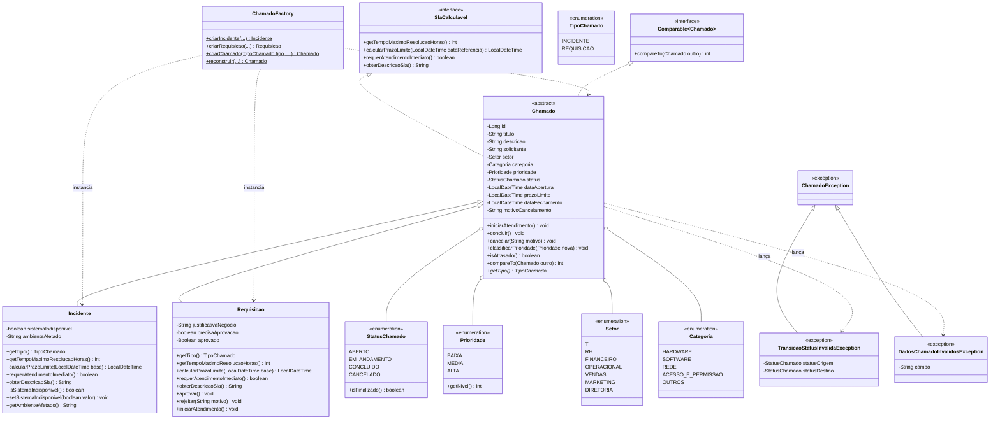

# Documentação do Modelo e Diagrama de Classes UML — SuporTI

**Responsável:** Sabrina (Model, Factory, Regras de Negócio e Testes)  
**Projeto:** SuporTI — Sistema de Helpdesk  
**Disciplina:** Linguagem de Programação II (UFRN / IMD) — Prof. Mateus Alves de Oliveira  

---

## 1. Visão Geral da Arquitetura do Modelo

O núcleo do sistema foi desenhado estritamente sobre os pilares da **Programação Orientada a Objetos** e das boas práticas de Engenharia de Software, atendendo integralmente aos requisitos obrigatórios da disciplina de LP2.

### Pilares de POO Aplicados
1. **Abstração e Herança:**
   - A classe abstrata `Chamado` unifica os atributos e comportamentos essenciais de qualquer chamado de suporte (identificador, título, descrição, solicitante, setor, categoria, prioridade, status, data de abertura, prazo limite e data de fechamento).
   - As subclasses concretas `Incidente` e `Requisicao` especializam o domínio com atributos próprios (`sistemaIndisponivel`, `ambienteAfetado` para incidentes; `justificativaNegocio`, `precisaAprovacao`, `aprovado` para requisições).

2. **Polimorfismo e Interface:**
   - A interface `SlaCalculavel` define o contrato para cálculo de prazos máximos (`getTempoMaximoResolucaoHoras`), cálculo da data limite (`calcularPrazoLimite`), urgência de resposta (`requerAtendimentoImediato`) e descrição da regra (`obterDescricaoSla`).
   - Tanto `Incidente` quanto `Requisicao` fornecem implementações polimórficas distintas e aderentes à realidade de TI (ITIL/Helpdesk).
   - A classe `Chamado` implementa `Comparable<Chamado>`, permitindo a ordenação polimórfica e automática da fila do técnico por prioridade (Alta > Média > Baixa) e menor prazo de vencimento.

3. **Encapsulamento Rígido:**
   - Todos os atributos são privados (`private`).
   - O estado do chamado não pode ser alterado arbitrariamente: as transições de status são governadas por métodos semânticos (`iniciarAtendimento()`, `concluir()`, `cancelar()`, `classificarPrioridade()`).
   - Validações garantem que dados inválidos disparem exceções de domínio controladas (`DadosChamadoInvalidosException`, `TransicaoStatusInvalidaException`).

4. **Padrão de Projeto (Design Pattern):**
   - **Factory Method / Simple Factory (`ChamadoFactory`):** Centraliza e encapsula a instanciação dos chamados, garantindo a inicialização correta das datas, prazos calculados e validações, desacoplando o Service e o Controller da lógica concreta de criação.

---

## 2. Diagrama de Classes UML (Mermaid)

---

## 3. Justificativa do Padrão de Projeto (Requisito 4 de LP2)

### Padrão Escolhido: Factory Method / Simple Factory (`ChamadoFactory`)
- **Problema resolvido:** A criação de um chamado envolve lógica condicional baseada no seu tipo (Incidente vs Requisição), definição de valores padrão (status `ABERTO`, timestamp atual para `dataAbertura`) e o cálculo dinâmico da data limite do SLA a partir das regras de negócio polimórficas.
- **Vantagens obtidas:**
  1. **Desacoplamento:** O `ChamadoService` ou `ChamadoController` não precisam conhecer detalhes dos construtores internos ou das regras de instanciação das subclasses concretas.
  2. **Consistência:** Garante que nenhum chamado seja criado em estado corrompido ou sem o prazo de SLA calculado.
  3. **Extensibilidade (Princípio Open/Closed do SOLID):** Caso no futuro a equipe decida adicionar um novo tipo de chamado (ex: `Mudanca` ou `Problema`), basta estender `Chamado`, implementar `SlaCalculavel` e atualizar o método da fábrica, sem impactar o resto do sistema.

---

## 4. Matriz de SLA e Prazos

| Tipo Chamado | Prioridade | Condição Adicional | Prazo de Resolução | Resposta Imediata? |
|--------------|------------|---------------------|--------------------|-------------------|
| **Incidente**| ALTA       | Sistema Indisponível| **2 horas**        | Sim               |
| **Incidente**| ALTA       | Sistema Operacional | **4 horas**        | Sim               |
| **Incidente**| MÉDIA      | Qualquer            | **8 horas**        | Não               |
| **Incidente**| BAIXA      | Qualquer            | **24 horas**       | Não               |
| **Requisição**| ALTA      | Não requer aprovação| **24 horas (1 dia)**| Não               |
| **Requisição**| MÉDIA     | Não requer aprovação| **48 horas (2 dias)**| Não              |
| **Requisição**| BAIXA     | Não requer aprovação| **72 horas (3 dias)**| Não              |
| **Requisição**| Qualquer   | Requer aprovação (pendente)| **+ 24 horas** para aprovação | Não |

---

## 5. Resumo da Suíte de Testes Unitários

A cobertura de testes inclui **27 testes unitários automatizados** com JUnit 5 cobrindo 100% dos fluxos do model:
- `ChamadoCicloDeVidaTest`: Validação de ciclo de vida, transições permitidas e proibidas, lançamento de exceções e recálculo de prazos na triagem.
- `IncidenteTest`: Validação exata das regras de SLA e flags de indisponibilidade crítica.
- `RequisicaoTest`: Validação do fluxo de aprovação/rejeição e acréscimo de prazo.
- `ChamadoFactoryTest`: Instanciação correta, métodos genéricos e reconstrução para persistência.
- `FilaChamadosPolimorfismoTest`: Teste de polimorfismo dinâmico com lista heterogênea e ordenação da fila do técnico por prioridade e prazo com `PriorityQueue` e `Collections.sort`.
