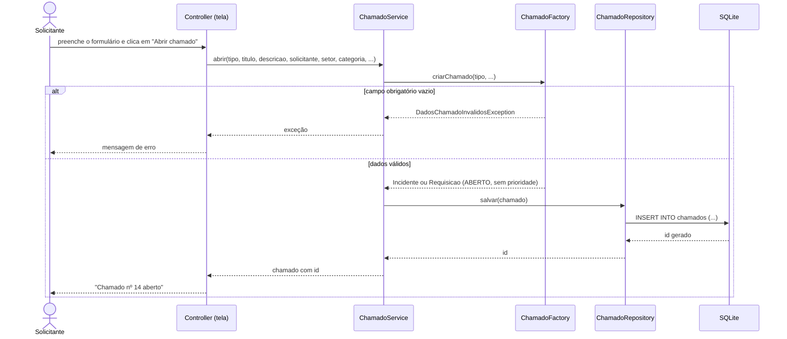
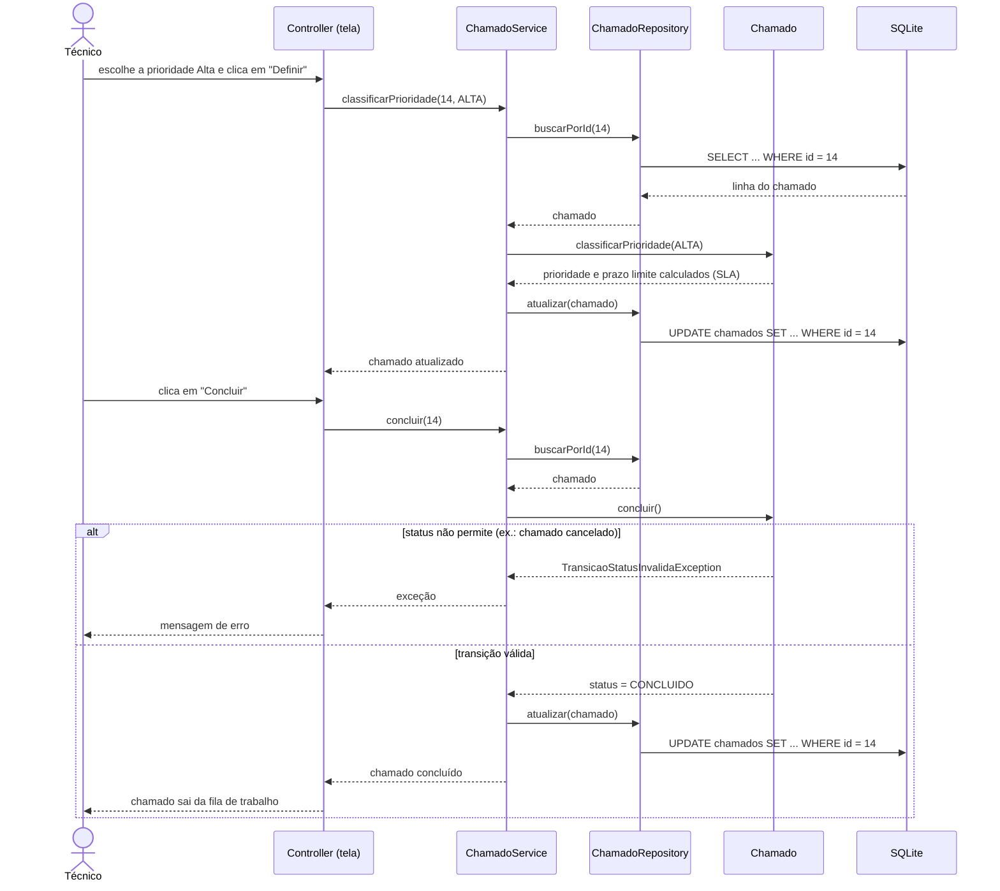
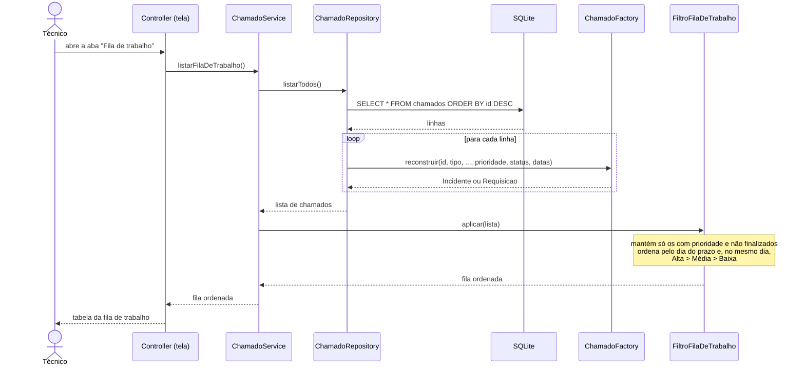

# Diagramas de Sequência — SuporTI

**Responsável:** Ana Paula (Persistência, Service e Filtros)  
**Projeto:** SuporTI — Sistema de Helpdesk  
**Disciplina:** Linguagem de Programação II (UFRN / IMD) — Prof. Mateus Alves de Oliveira  

---

## Como ler estes diagramas

Um diagrama de sequência mostra **quem conversa com quem, e em que ordem**, quando uma ação acontece no sistema.

- Cada **caixa no topo** é um participante (uma classe ou o banco de dados), e a linha que desce dela é a sua "linha do tempo".
- O tempo corre **de cima para baixo**.
- **Seta cheia (`→`)** é uma chamada de método.
- **Seta tracejada (`⇢`)** é o retorno dessa chamada.
- O bloco **`alt`** mostra caminhos alternativos (por exemplo: deu certo / deu erro).

Os três fluxos abaixo atravessam todas as camadas do sistema:

```
Tela (Controller) → ChamadoService → ChamadoFactory / Chamado (model)
                                   → ChamadoRepository → SQLite
                                   → FiltroChamado (Strategy)
```

---

## 1. Solicitante abre um chamado

O solicitante preenche o formulário. O service pede à **Factory** o tipo certo de chamado (`Incidente` ou `Requisicao`), que já nasce **ABERTO e sem prioridade**, e o **repository** grava no banco.



**Pontos de POO neste fluxo**
- **Padrão Factory:** o service não escolhe a subclasse; a `ChamadoFactory` decide entre `Incidente` e `Requisicao`.
- **Encapsulamento:** a validação dos campos acontece dentro do construtor do `Chamado`. Um chamado inválido nem chega a existir.

---

## 2. Técnico faz a triagem e conclui o chamado

Toda ação do técnico segue o mesmo roteiro no service: **buscar** o chamado no banco, pedir ao **próprio `Chamado`** para mudar e **gravar** a mudança. Quem decide se a mudança é permitida é o `Chamado`, e não a tela nem o service.



**Pontos de POO neste fluxo**
- **Encapsulamento:** `status` e `prioridade` não têm setter. Só mudam pelos métodos do `Chamado`, que validam as regras.
- **Polimorfismo (interface `SlaCalculavel`):** ao classificar a prioridade, o prazo é calculado de forma diferente por `Incidente` e por `Requisicao`.
- **Separação de camadas:** o service orquestra, o model decide, o repository persiste.

---

## 3. Técnico abre a fila de trabalho

Para montar qualquer lista, o repository lê todas as linhas do banco e as transforma de volta em objetos com o `ChamadoFactory.reconstruir`. Depois, o **filtro** escolhe quais chamados aparecem e em que ordem.



**Pontos de POO neste fluxo**
- **Padrão Strategy (interface `FiltroChamado`):** o service chama `aplicar(...)` sem saber qual filtro é. A mesma chamada serve para a tela do solicitante (`FiltroPorSetor`) e para a aba de triagem (`FiltroAguardandoTriagem`).
- **Reconstrução pelo domínio:** o `reconstruir` recria o chamado como ABERTO, aplica a prioridade e leva até o status salvo pelos próprios métodos do `Chamado`. Assim as regras de negócio valem também ao ler do banco.